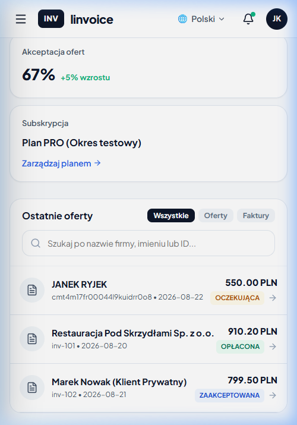
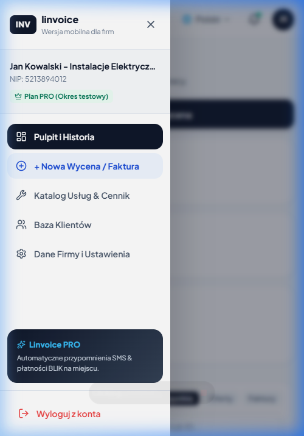
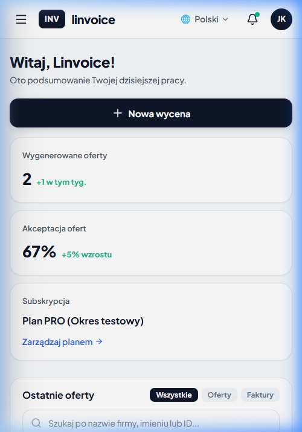

# linvoice

linvoice to aplikacja do przygotowywania wycen i faktur na telefonie. Jest pomyślana dla fachowców, którzy chcą zrobić wycenę jeszcze u klienta, np. po obejrzeniu instalacji albo ustaleniu zakresu remontu.

Wybierasz klienta, dodajesz pozycje z własnego cennika i sprawdzasz podsumowanie. Gotowy dokument możesz pobrać jako PDF. Z jego podglądu możesz też otworzyć WhatsApp z gotową wiadomością do klienta. W historii sprawdzisz status dokumentu i oznaczysz fakturę jako opłaconą.

Aplikacja szuka danych firmy po NIP w białej liście VAT. Jeśli nie znajdzie wpisu, podstawi dane przykładowe. Pola kontaktowe też mogą zawierać dane testowe, więc przed wystawieniem dokumentu warto je sprawdzić.

Dokumenty, klienci i cennik są zapisywane w przeglądarce (`localStorage`). Logowanie i subskrypcja PRO działają w trybie demonstracyjnym.

## Zrzuty ekranu

<p align="center">
  
  
  
  
  
</p>

## Uruchomienie lokalne

Projekt używa Reacta, TypeScriptu i Vite. Wersja Node.js zapisana w `.node-version` to `22.12.0`.

```bash
git clone https://github.com/Diabue/Linvoice.git
cd Linvoice
npm install
npm run dev
```

Na komputerze otwórz `http://localhost:5173/`. Żeby sprawdzić widok na telefonie, połącz go z tą samą siecią Wi-Fi i otwórz adres `Network` wypisany przez Vite w terminalu.
